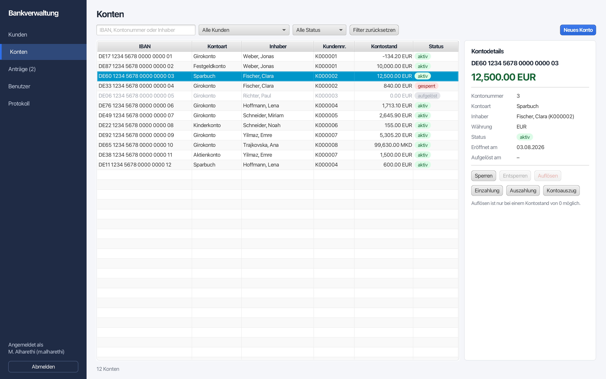
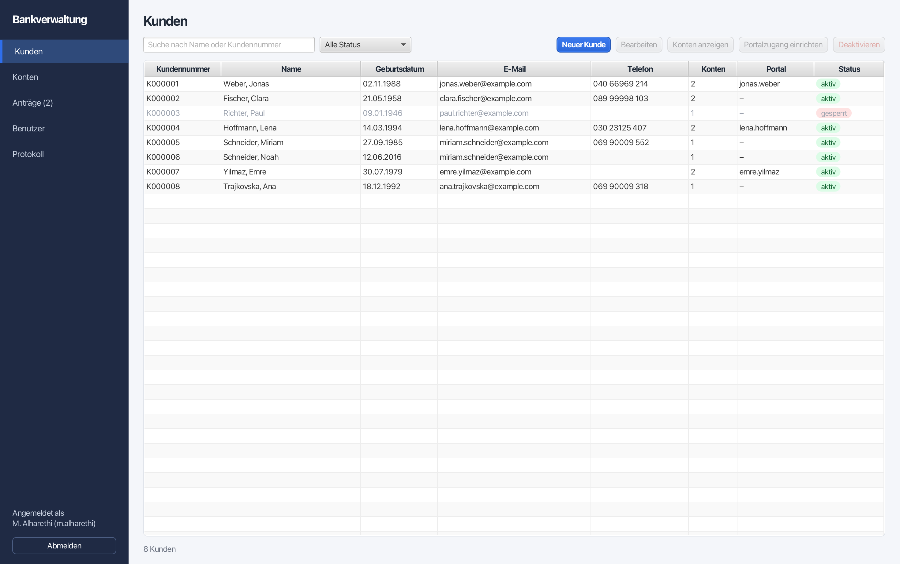
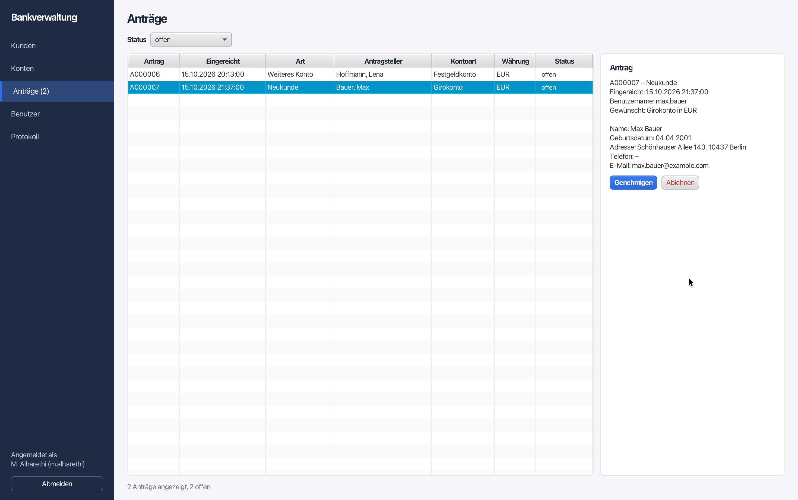
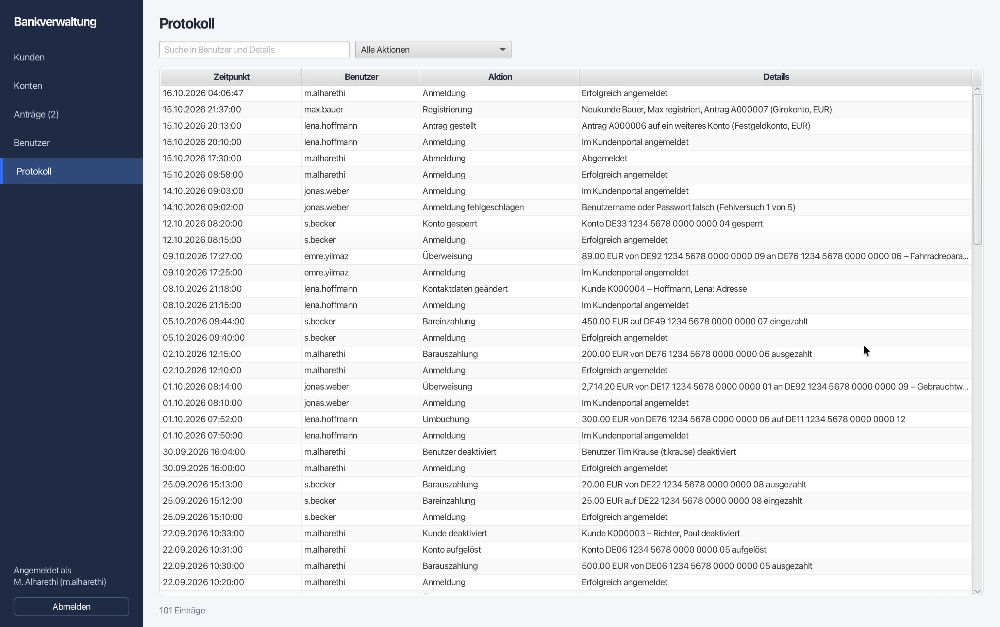
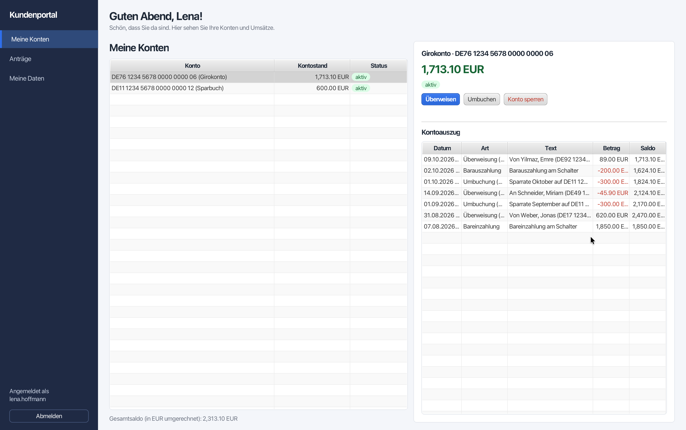

# Bankproject

[](https://github.com/alm7h/Bankproject/actions/workflows/build.yml)


[](LICENSE)

A Java 21 + JavaFX learning project that models a small banking domain and includes a JavaFX application with one login for two groups: staff manage customers, accounts, applications and staff users in the **Verwaltung**, clients open accounts, transfer money and read their statements in the **Kundenportal**. The project demonstrates clean domain modeling (accounts, customers, money, currencies), design patterns (Template Method, Abstract Factory, Observer), collections/streams, concurrency with `ExecutorService`, persistence via Java serialization, a thorough unit test suite (JUnit 5 + Mockito), and code quality tooling (SpotBugs, JaCoCo, Javadoc).

This repository is intended for teaching/learning purposes but is structured like a production Maven project so you can build, test, and package it easily.


*The Verwaltung (Konten): every account with type, owner, balance and status, details and actions for the selected one. All screenshots show invented demo data.*


## Contents
- Overview
- Features
- Domain rules
- Verwaltung app (login, customers, accounts, applications, users)
- Kundenportal (client portal)
- Tech stack
- Project layout
- Getting started
  - Prerequisites
  - Build
  - Run (JavaFX UI)
  - Run demo programs
  - Run tests and coverage
  - Generate static analysis and docs
  - Package an archive
- Tests
- Usage notes (JavaFX specifics)
- Troubleshooting
- Contributing
- License


## Overview
Core domain packages live under `bankprojekt.*`:
- `bankprojekt.basisdaten` — Core banking entities: the abstract `Konto` (account) with `Girokonto`, `Sparbuch`, `Festgeldkonto` and `Kinderkonto`, plus `Geldbetrag` (money), `Waehrung` (currency) and `Kunde` (customer).
- `bankprojekt.verwaltung` — The `Bank` aggregate which manages accounts, transfers, reports and persistence, and the Verwaltung logic on top of it: `Bankverwaltung` (customer and account records, staff users, client logins, account applications, statements, audit log), `Kundenportal` (everything a client does himself), `Anmeldung` (one login for staff and clients, with lockout), `Passwortschutz` (PBKDF2 password hashing) and `Datenspeicher` (saves everything to a file).
- `bankprojekt.fabriken` — Abstract-Factory layer (`Kontofabrik` + one factory per account type) used by `Bank.kontoErstellen`.
- `bankprojekt.aktienhandel` — Stock trading with concurrency: `Aktie` changes its price in the background, `Aktienkonto` places buy/sell orders that wait for the right price.
- `bankprojekt.exceptions` — Domain exceptions `GesperrtException` and `UngueltigeKontonummerException`.
- `bankprojekt.nuetzliches` — Helpers: `Kalender` (injectable "today") and `EinAusgabe` (console input).
- `bankprojekt.oberflaeche` — The JavaFX app (FXML + controllers), launched through `Start`: shared login, the Verwaltung (Kunden, Konten, Anträge, Benutzer, Protokoll), the registration wizard for new clients and the Kundenportal (Meine Konten, Anträge, Meine Daten).

The `spielereien` package holds runnable `main` demo programs (the presentation layer) that exercise the domain and print to the console / write files — the business classes themselves never print.


## Features
- Multiple account types with deposits, withdrawals, and transfers
- Withdrawal rules per account type via a Template Method (`Konto.abheben` with the hook `pruefeAbhebung`)
- Account factories to encapsulate creation logic
- Money in several currencies (EUR, MKD, KMF, STN), compared by euro value and rounded to cents
- Bank-level queries with streams: totals by customer, customers with a negative balance, birthdays, seniors count, a gift for new adults
- Transfers between accounts with rollback if crediting fails
- Stock trading: shares change their price on a `ScheduledExecutorService`, orders return a `Future` and wait for the price without `sleep()`
- JavaFX Verwaltung for staff (FXML + controllers): manage customers, accounts, applications and staff users, cash deposits/withdrawals at the counter, audit log of every action
- JavaFX Kundenportal for clients: register as a new client with a guided wizard, apply for accounts (approved or rejected by staff), see balances and statements, transfer to other Girokonten by IBAN, move money between own accounts, lock an account, change contact data and password
- Passwords stored only as salted PBKDF2 hashes; login locked for 60 s after 5 failed attempts
- Persistence: save/load a whole bank via Java serialization, several banks in one zip file; the app saves all its data automatically after every change
- Unit tests with JUnit 5 and Mockito (about 810 tests, including the JavaFX UI); the build fails if a class of the Verwaltung logic or the UI drops below 90 % coverage, and deliberately inserted bugs in the key rules are caught by the tests
- Code quality: SpotBugs static analysis, JaCoCo coverage, Javadoc generation


## Domain rules
A few rules the code enforces (and the tests check):
- **A locked account (`gesperrt`) allows no bookings:** withdrawing, depositing, sending or receiving transfers, cancelling fixed-term money and stock orders all throw `GesperrtException`.
- **Girokonto:** may be overdrawn down to `-dispo`; the dispo must be greater than 0.
- **Sparbuch:** at most 2,000 € per calendar month, and at least 0.50 € must remain.
- **Kinderkonto:** at most 50 € per withdrawal, no overdraft.
- **Festgeldkonto:** only the amount cancelled beforehand (`kuendigen`) can be withdrawn, at most the balance.
- **Aktienkonto:** no overdraft; a buy order without enough balance or for an unknown share buys nothing (0 €).
- **Account numbers** are handed out by the `Bank`; a failed account creation uses up no number. `getKonten()` returns a read-only view.
- **`Geldbetrag`** is immutable; `plus`, `minus`, `mal` and `umrechnen` round to cents.
- **Verwaltung:** customers and staff users are never deleted, only deactivated; an account can only be closed at a balance of 0 and then stays locked; every action is logged with user and time.
- **Kundenportal:** a client sees and uses only his own accounts; transfers go from a Girokonto to an active Girokonto of the same bank; moving money between own accounts follows the rules of the sending account and debits nothing if the receiving account can't be credited; an account the client locks can only be unlocked by staff; a deactivated customer can't log in.


## Verwaltung app (login, customers, accounts, applications, users)
`./mvnw javafx:run` starts the app. Staff and clients use the same login screen; the app opens the Verwaltung for staff and the [Kundenportal](#kundenportal-client-portal) for clients (usernames are unique across both).

**Login.** Everyone logs in with a username and password. Wrong credentials show an error and clear the password field; after 5 failed attempts the login is locked for 60 seconds. No screen of the Verwaltung or the Kundenportal is reachable without a successful login, and every action is executed in the name of the logged-in user.

On the very first start (no data file yet) one user is created:

| Username | Password |
|---|---|
| `m.alharethi` | `1234` |

> **⚠️ Development only:** the seed password `1234` is meant for development and testing. Change it before any real use: log in, open **Benutzer**, select `m.alharethi` and click **Passwort zurücksetzen**.

**Views** (sidebar on the left, **Abmelden** logs out):
- **Kunden** — search by name or customer number, filter by status; create and edit customers (customer number `K000001`… is assigned automatically; first/last name, date of birth, address, e-mail required, phone optional and validated); deactivate (with confirmation) and reactivate. Customers are never deleted; a deactivated customer gets no new accounts and can't log in to the Kundenportal. "Portalzugang einrichten" gives an existing customer a portal login with a start password; "Portalpasswort zurücksetzen" helps a client who forgot his. In both cases the client must choose his own password at the next login.
- **Konten** — search by account number, IBAN or owner, filter by customer and status; open an account for a customer (Girokonto with dispo, Sparbuch, Festgeldkonto, Kinderkonto, Aktienkonto; currency; opening balance 0; account number and German IBAN assigned automatically); details with live balance; cash deposit and withdrawal at the counter (the account type's rules apply); the account statement; block (with confirmation), unblock, close (with confirmation, only at a balance of 0 — the account then stays locked and is kept). A customer can have several accounts.
- **Anträge** — account applications from the Kundenportal (the sidebar shows how many are open). Approve (with a dispo for a Girokonto; for a new client this creates the customer and the account) or reject with a reason the client sees.
- **Benutzer** — staff users: create, edit the display name, reset a password, deactivate (with confirmation; not yourself) and reactivate.
- **Protokoll** — read-only audit log: who did what and when (logins, failed logins, lockouts, logouts — also when the window is closed — registrations, applications and decisions, transfers, every create/edit/block/close).

| Kunden | Anträge | Protokoll |
|---|---|---|
|  |  |  |

**Data file.** All data (bank, customers, accounts, users, client logins, applications, statements, audit log) is saved with Java serialization after every change to `~/.bankprojekt/verwaltung.ser`. Another file can be chosen with `-Dbankprojekt.datei=/path/to/file.ser`. Deleting the file resets the app to the seed user (all data is lost). Files saved by the earlier version without the Kundenportal can still be loaded.


## Kundenportal (client portal)
Clients use the same login screen as staff.

**New clients** click **"Neu hier? Konto eröffnen"** on the login screen. A wizard with greeting texts guides them through five steps: welcome, personal data, choice of account (each type with a short description, plus currency), username and password, and a summary. "Antrag absenden" sends the application to the staff and shows a thank-you page ("Vielen Dank, Anna! Ihr Antrag A000001 …"). The client can log in right away and follow the application; the account appears once staff approve it in **Verwaltung → Anträge**. After a rejection the client sees the reason and can apply again.

**In the portal** (greeting by time of day, sidebar with Abmelden):
- **Meine Konten** — own accounts with live balances and a total in EUR; per account the statement (newest first, outgoing amounts in red) and the actions **Überweisen** (from a Girokonto to any active Girokonto of the bank, by IBAN), **Umbuchen** (between own accounts; the rules of the sending account apply, e.g. dispo or the Sparbuch limit) and **Konto sperren** (after confirmation; only the bank can unlock).
- **Anträge** — status of each application with the opened account or the rejection reason; "Weiteres Konto beantragen".
- **Meine Daten** — customer data, change address/phone/e-mail, change the password.


*The Kundenportal (Meine Konten): own accounts with the total in EUR and the statement of the selected account.*

Money comes into accounts through cash deposits at the counter (Verwaltung → Konten → Einzahlung) or transfers.


## Tech stack
- Language: Java 21
- Build: Apache Maven (Maven wrapper included)
- CI: GitHub Actions
- UI: JavaFX (OpenJFX `javafx-controls`, `javafx-fxml`)
- Money rounding: decimal4j
- Testing: JUnit 5 (Jupiter) + Mockito
- Analysis: SpotBugs, JaCoCo, Javadoc

See `pom.xml` for exact versions and plugins.


## Project layout
```
/ (project root)
├─ .github/workflows/build.yml   # CI: build and test on every push and pull request
├─ mvnw, mvnw.cmd, .mvn/         # Maven wrapper
├─ pom.xml
├─ src
│  ├─ main
│  │  ├─ java
│  │  │  ├─ bankprojekt
│  │  │  │  ├─ basisdaten/        # Core domain entities (accounts, money, currency, customer)
│  │  │  │  ├─ verwaltung/        # Bank, Bankverwaltung, Kundenportal logic, login, password hashing, data file
│  │  │  │  ├─ fabriken/          # Factories for accounts
│  │  │  │  ├─ aktienhandel/      # Shares and stock account (concurrency)
│  │  │  │  ├─ exceptions/        # Domain exceptions
│  │  │  │  ├─ nuetzliches/       # Kalender, console input
│  │  │  │  └─ oberflaeche/       # JavaFX app: login, Verwaltung, registration, Kundenportal
│  │  │  └─ spielereien/          # Runnable demo programs
│  │  └─ resources
│  │     └─ bankprojekt/oberflaeche/  # FXML views and forms + verwaltung.css
│  └─ test
│     ├─ java/bankprojekt/        # Unit and UI tests, same packages as the classes they test
│     └─ resources/               # test-only files (e.g. a deliberately broken FXML file)
├─ docs/screenshots/             # screenshots of the app for this README
├─ LICENSE
├─ NOTICE                        # files based on course material (not under the MIT License)
└─ README.md
```


## Getting started

### Prerequisites
- Java Development Kit (JDK) 21 or newer
- No Maven installation needed: the repository contains the Maven wrapper (`mvnw` / `mvnw.cmd`), which downloads the right Maven version (3.9.9) on first use. The commands below use `./mvnw` (Windows: `mvnw.cmd`); with Maven 3.9+ installed you can write `mvn` instead.

Verify your environment:
```
java -version
./mvnw -version
```

### Build
```
./mvnw -q -DskipTests package
```
This compiles sources and packages the project. Use `./mvnw package` (without `-DskipTests`) to include running tests.

### Run (JavaFX UI)
The easiest way is the JavaFX Maven plugin:
```
./mvnw javafx:run
```
Alternatively, launch the non-`Application` bootstrap class `Start` from the classpath:
```
./mvnw -q -Dexec.mainClass=bankprojekt.oberflaeche.Start exec:java
```
Notes:
- Run `Start` (not `BankAnwendung`) to avoid the classic "JavaFX runtime components are missing" error when JavaFX is resolved via Maven on the classpath.
- Log in with `m.alharethi` / `1234` (development only, see [Verwaltung app](#verwaltung-app-login-customers-accounts-applications-users)).
- To try things out without touching your real data, start with a separate data file:
  ```
  ./mvnw -q -Dexec.mainClass=bankprojekt.oberflaeche.Start -Dbankprojekt.datei=/tmp/test.ser exec:java
  ```

### Run demo programs
The demo programs live in `spielereien`. The default main class for `exec:java` is `spielereien.KontenSpielereien` (set as the `exec.mainClass` property in `pom.xml`). To run it:
```
./mvnw -q exec:java
```
Or run any other main class, e.g.:
```
./mvnw -q -Dexec.mainClass=spielereien.Bankspielereien exec:java
```
Available demos:
- `spielereien.KontenSpielereien` — interactive: creates an account and asks how much to withdraw
- `spielereien.Bankspielereien` — the bank's stream reports, with the expected results printed alongside
- `spielereien.BankPersistenzSpielereien` — saves two banks into `bankdatei.zip` and reads them back (writes the file into the current directory)
- `spielereien.Aktienspielereien` — several buy/sell orders running at the same time (waits for real price changes, can take a minute or two)
- `spielereien.KundenUndKontenSortieren` — interactive: sorting customers and accounts

### Run tests and coverage
```
./mvnw -q test
```
A JaCoCo coverage report is generated during tests. It covers all of `bankprojekt`, including the JavaFX UI. `./mvnw verify` additionally checks that every class in `bankprojekt.verwaltung` and `bankprojekt.oberflaeche` has at least 90 % line and branch coverage and fails otherwise. Only the two JavaFX entry points `Start` and `BankAnwendung` are exempt: `Application.launch` can run only once per JVM, and `start` shows the window. Their logic lives in the tested `Fenstersteuerung`. Find the HTML report in:
```
./target/site/jacoco/index.html
```
Every push and pull request is also built and tested by GitHub Actions (`.github/workflows/build.yml`) with JDK 21, once with the default and once with a German locale. The build runs under `xvfb-run`, a virtual screen that JavaFX needs for the UI tests. The JaCoCo report of each run can be downloaded from the run's page (artifact `jacoco-report`).
Run a single test class or method:
```
./mvnw -q test -Dtest=BankTest
./mvnw -q test -Dtest=BankTest#methodName
```

### Generate static analysis and docs
- SpotBugs HTML report:
  ```
  ./mvnw -q compile
  open target/site/spotbugs.html   # or view the file in your browser
  ```
- Javadoc (package-level visibility and above):
  ```
  ./mvnw -q package
  open target/site/apidocs/index.html
  ```

### Package an archive (assembly)
A simple assembly is configured for submissions/packaging and runs as part of `package`:
```
./mvnw -q package
```
The archive `target/Bankproject-1.0-SNAPSHOT-submission.zip` contains the sources, `pom.xml` and the generated reports (SpotBugs, JaCoCo and Javadoc).


## Tests
The test suite lives in `src/test/java/bankprojekt`, in the same packages as the classes under test, and uses only JUnit 5 and Mockito.

- **About 810 tests**, around 98–99 % line and branch coverage of `bankprojekt`, UI included.
- Every account type, `Geldbetrag`, `Waehrung`, `Kunde`, the factories, the `Bank` (including transfers, reports and persistence), the exceptions and `Kalender` have their own test classes, as do the Verwaltung classes `Bankverwaltung` (plus `BankverwaltungPortalTest` for applications, portal logins and counter bookings), `Kundenportal`, `Kundendaten`, `Anmeldung` (lockout with an adjustable test clock), `Passwortschutz` and `Datenspeicher`, and every screen of the Verwaltung, the registration wizard and the Kundenportal.
- Test names and comments are in German, e.g. `geldAbheben_gibtFalse_wennUeberDispo`.
- The suite does not depend on the computer's language settings: locale-dependent output is tested with `Locale.GERMANY`, set and restored around each test. To double-check:
  ```
  ./mvnw -q test -DargLine="-Duser.language=de -Duser.country=DE"
  ```
- The JavaFX UI is tested with plain JUnit, without an extra test library. The extension `JavaFxErweiterung` starts JavaFX once and runs every test on the JavaFX thread. Tests load the real FXML views, type into fields and press buttons. Modal dialogs are answered in code (`Dialogantworten`), so no window ever opens, and an unexpected dialog fails the test. The login lockout is tested with an adjustable clock.
- Coverage alone doesn't prove the tests would notice a mistake, so the key rules were also checked by inserting bugs on purpose (e.g. other clients' accounts treated as one's own, a locked account accepting money, a deactivated customer logging in, outgoing amounts shown as positive, the forced password change skipped). The tests catch all of them; where one slipped through at first, the test was made stricter.
- The stock trading tests contain no `sleep()`: they wait for results with `Future.get(timeout)` and use price limits that are met immediately, so they don't depend on random price changes.


## Usage notes (JavaFX specifics)
- Entry point: `bankprojekt.oberflaeche.Start` calls `Application.launch(BankAnwendung.class, args)`, ensuring JavaFX starts even when OpenJFX is provided via Maven dependencies (classpath) rather than module path.
- If you run the `BankAnwendung` class directly without JavaFX modules on the module path, the JVM may exit early with: "JavaFX runtime components are missing". Always run `Start` instead when launching via Maven.
- The warning "Unsupported JavaFX configuration: classes were loaded from 'unnamed module'" is expected when JavaFX runs from the classpath (`exec:java`) and can be ignored; `javafx:run` puts JavaFX on the module path and avoids it.


## Troubleshooting
- JavaFX runtime components are missing
  - Symptom: JVM exits before your code runs.
  - Fix: Start the UI with `./mvnw javafx:run`, or launch `bankprojekt.oberflaeche.Start` instead of `BankAnwendung`:
    ```
    ./mvnw -q -Dexec.mainClass=bankprojekt.oberflaeche.Start exec:java
    ```
- Java not found or wrong version
  - Ensure JDK 21 or newer is installed and active: `java -version` should show `21` or higher.
- Number and date formats look different
  - Amounts and dates are printed in the format of your computer's language settings (e.g. `1,234.50 EUR` or `1.234,50 EUR`). This is intended; the tests pass with any setting.
- Login fails although the password is right
  - Check the username: the seed user is `m.alharethi` (with `m.`). For security the error message doesn't say whether the username or the password was wrong; staff can see every failed attempt with the entered name under **Protokoll**.
- Login is locked ("Zu viele Fehlversuche")
  - After 5 failed attempts the login is locked for 60 seconds; the countdown shows the remaining time. Restarting the app also clears the lock.
- Forgot the password / start over
  - Clients: staff reset it under **Kunden → Portalpasswort zurücksetzen**; the client then sets his own at the next login.
  - Staff: another active user can reset it under **Benutzer → Passwort zurücksetzen**. If no one can log in, delete `~/.bankprojekt/verwaltung.ser`; the next start creates the seed user again (all data is lost).
- An interactive demo stops at the second question when input is piped in
  - `KontenSpielereien` reads its two answers with two separate readers. Type the answers yourself instead of piping them in all at once.


## Contributing
Contributions are welcome for educational improvements and additional examples. Suggested areas:
- Additional account operations and edge cases (with tests)
- Further Verwaltung features (reports, transfers by staff, roles and permissions)
- Further Kundenportal features (cancelling fixed-term deposits, stock trading)
- Documentation and comments (the code comments and Javadoc are in German)

Please open an issue or pull request.


## License
Released under the [MIT License](LICENSE) — © 2026 Mohameed Al-Harethi.

**Exception: course material.** This project was written for a university course, and parts of it are based on the course material. The files that still carry the course instructor's `@author` tag (`Aktie`, `Girokonto`, `Kunde`, `Sparbuch`, `GesperrtException`, `KontenSpielereien`) are not fully covered by the MIT License; see [NOTICE](NOTICE).
